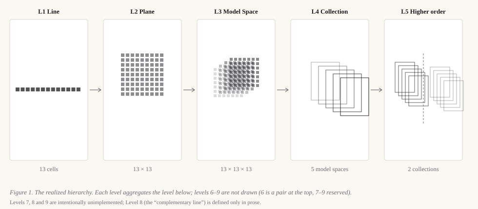
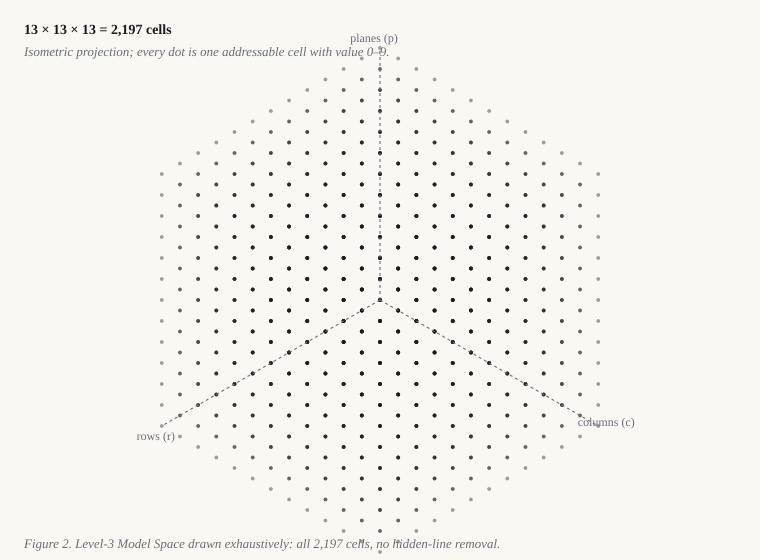
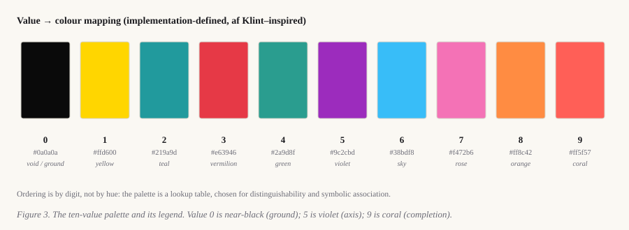
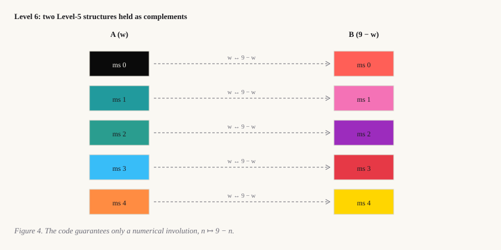
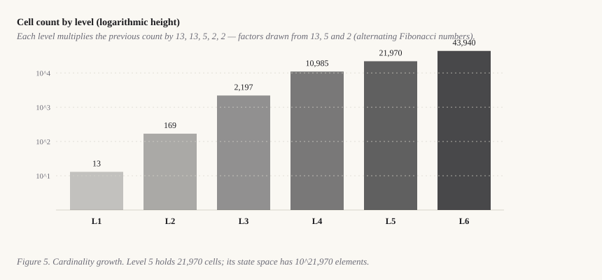

# The Cosmic Block

## A Hierarchical Integer Tensor as an Interdisciplinary Artifact

**An academic paper on the computational model, its visualization, and its readings in mathematics, physics, art history, and spiritual science**

---

### Abstract

The *Cosmic Block* is a hierarchical data structure built from a single primitive: an integer *cell* constrained to the ten values `0–9`, initialized to zero. Cells nest into five implemented levels — a line (Level 1), a plane (Level 2), a model space (Level 3), a collection of model spaces (Level 4), and a higher-order collection (Level 5) — with Level 6 documented as a complement relationship. The default dimensions (`13`, `13×13`, `13×13×13`, `5`, `2`) were chosen as an interpretive response to a painting by the Swedish abstract pioneer Hilma af Klint (1862–1944). This paper documents the model as built, states precisely what was and was not verified, and then reads it through four lenses. In **mathematics**, the model is a nested family of tensors over the ring ℤ₁₀, with an address space that is a three-dimensional vector space over the field 𝔽₁₃, and a natural complement involution `n ↦ 9 − n` that partitions the ten values into five complementary pairs. In **physics**, it is read as a discrete, quantized scalar field on a 13³ torus and, more speculatively, as a ℤ₁₀ lattice gauge configuration space. In **art history**, it is a computational *restitution* of af Klint's formal devices — grid, series, symmetry, complementary pair, diagrammatic colour — situated in her Theosophical and spiritist milieu. In **spiritual science**, the value-to-colour mapping is traced to the Theosophical thought-form tradition of Besant and Leadbeater (1901) and to the "spiritual science" (Geisteswissenschaft) of Rudolf Steiner. The paper is deliberately explicit about its epistemic limits: the reference painting was never decoded by the author-agent's image pipeline, so the dimensional choices are *assumptions*, not measurements; and the metaphysical readings are offered as interpretations, not claims. This revision adds a citation-first grounding in Rachel Villari's 2026 study of the *Atom* and *Tree of Knowledge* and in a local English translation of the transcribed Hilma notebooks. Neither source decodes the painting, and the notebook translations are working research copies rather than a scholarly edition. The contribution is therefore double: a working, tested implementation of a small formal system, and a case study in how one object can be made legible to four disciplines at once — and where that legibility breaks down.

**Keywords:** integer tensor, Hilma af Klint, abstract art, Theosophy, anthroposophy, 𝔽₁₃, ℤ₁₀, lattice field, complementary pair, boundary object, TypeScript, Three.js

---

## Contents

1. [Introduction](#1-introduction)
2. [The formal object](#2-the-formal-object)
3. [Computational realization](#3-computational-realization)
4. [The visual language](#4-the-visual-language)
5. [Mathematical readings](#5-mathematical-readings)
6. [Physical readings](#6-physical-readings)
7. [Art-historical readings](#7-art-historical-readings)
8. [Spiritual-scientific readings](#8-spiritual-scientific-readings)
9. [Discussion: an interdisciplinary boundary object](#9-discussion-an-interdisciplinary-boundary-object)
10. [Conclusion and future work](#10-conclusion-and-future-work)
11. [Methodological appendix: what was actually verified](#appendix-a-methodological-appendix-what-was-actually-verified)
12. [References](#references)

---

## 1. Introduction

### 1.1 Motivation

Most data structures are named for their use. An array, a tree, a hash map — each is a solution to a problem posed elsewhere. The *Cosmic Block* is unusual in that its shape is not prescribed by an application but by an *image*. It began as an attempt to give a precise computational form to a promise: that a painter, working between 1906 and 1915 without any mathematical formalism available to her, had arranged nested sequences of marks whose *relative lengths* carried meaning. The task was to translate that arrangement into a structure that a computer could hold, validate, and render — and then to ask what the result means to different scholarly communities.

This paper is the record of that translation. It has two halves that are best read as one argument. The first half (§2–§4) is technical: what the object is, how it is built, what was verified. The second half (§5–§8) is interpretive: four disciplinary readings of the same object, each with its own vocabulary, and each with explicit limits. §9 argues that the object functions as a *boundary object* in the sense of Star and Griesemer (1989) — plastic enough to be used by different communities, robust enough to retain an identity across them.

### 1.2 Contributions

1. **A formal specification** of a nested integer-tensor hierarchy with a single validation rule (`0 ≤ cell ≤ 9`) and zero initialization (§2).
2. **A working implementation** in TypeScript, compiled strictly and exercised at runtime, spanning Levels 1–5 (§3, Appendix A).
3. **A programmatic visual language** — five figures generated by code, plus a value-to-colour palette — that keeps rendering independent of the mathematical model (§4).
4. **Four disciplinary readings** with worked examples, including some genuinely surprising mathematics (the complement involution, the 𝔽₁₃ address space) and a historically sourced account of af Klint's milieu (§5–§8).
5. **A candid methodological account** of what was and was not checked, including the failure to decode the source painting (§1.3, Appendix A).
6. **A source-grounded revision** that separates Villari's historical reports, wording in the transcribed notebooks, and this project's interpretations; the translated-note corpus is used to constrain claims, not to manufacture a numeric decoding (Appendix A.5).

### 1.3 Epistemic status: an honest caveat up front

A scholarly account must state its evidentiary basis. The following is not rhetoric; it is a defect that a reader should weigh.

> **Caveat 1 (the painting was not measured).** The reference painting was supplied to the agent that built this model. The agent's image-reading path returned no pixels (the file handle yielded zero lines; the browser and file-system routes available to the runtime were either blocked or inapplicable). Consequently **no dimension in this model was derived from the painting by measurement**. The defaults `13`, `5`, `2` are interpretive assumptions, chosen for structural resonance and justified *post hoc* in §2.5 and §5. A human who can view the painting should treat these as falsifiable: if the painting encodes different proportions, the defaults should change. The model is built so that they can.

> **Caveat 2 (the model is a state space, not a dynamical theory).** Nothing in the implementation specifies evolution, energy, or time. Where §6 speaks of "physics", it speaks of *kinematics and configuration spaces*, never of dynamics.

> **Caveat 3 (metaphysics is flagged).** §8 reports what a tradition *claims* and what formal echoes exist. It does not assert that the model verifies any spiritual doctrine.

> **Caveat 4 (no formal test framework for the TypeScript build).** Verification (Appendix A) was by ad-hoc runtime scripts, not a versioned suite. This is a real gap, not a stylistic one. A separate C11 implementation now has its own test program, but it is outside the TypeScript verification claims made here.

> **Caveat 5 (translated notes are working translations).** The English notebook corpus was produced locally by machine translation with a terminology glossary, not by human scholarly editing. It preserves page geometry and images, and is reliable enough to locate and contextualise passages; it is not a basis for fine-grained quotation or for claiming that af Klint encoded a tensor, a palette, or a set of dimensions. Quoted note wording in this paper is taken from the transcribed source text, and the English renderings are explicitly glosses.

Readers are asked to hold these caveats in mind: the paper's ambition is interdisciplinary *honesty*, which means stating where each reading is strong and where it thins out.

---

## 2. The formal object

### 2.1 The primitive: a cell

The entire hierarchy is generated from one type.

> **Cell.** An integer `w` with `0 ≤ w ≤ 9`, initial value `0`.

Every cell is validated before it enters the structure; any value outside `[0, 9]` raises an error (`TypeError` for non-numbers, `RangeError` for out-of-range integers). The set of admissible values is written **𝔻 = {0,1,…,9}**.

The choice of ten values is not neutral. Ten is the base of decimal counting, it is composite (`10 = 2 × 5`), and — as §5 shows — it is exactly the size that admits a fixed-point-free complement pairing. Whether af Klint intended any of this is unknowable; what matters here is that the constraint is a genuine design decision with mathematical consequences.

### 2.2 Levels 1–3: line, plane, space

The realized core is a three-step nesting.

| Level | Name | Type (conceptual) | Default shape | Cells |
|---|---|---|---|---|
| 1 | **Line** | `number[]` | `13` | 13 |
| 2 | **Plane** | `number[][]` (array of lines) | `13 × 13` | 169 |
| 3 | **Model Space** | `number[][][]` (array of planes) | `13 × 13 × 13` | 2,197 |

Each level is *conceptually distinct*: a plane is not "a big line" in the API, and a model space is not "a big plane". They have separate constructors (`createLine`, `createPlane`, `createConfig`), separate accessors (`getAt`, `planeGetAt`, `modelSpaceGetAt`), separate zero-checks, and separate concatenation operators (concatenation along a line; horizontal/vertical concatenation of planes; depth concatenation of model spaces). A cell address in the model space is written as an ordered triple `(p, r, c)` — plane, row, column — and the value there is `M[p][r][c]`.



*Figure 1. The realized hierarchy. Each level aggregates the level below. Level 6 is a pair of Level-5 structures; Levels 7–9 are reserved and unimplemented.*



*Figure 2. The Level-3 Model Space drawn exhaustively: all 2,197 cells of the default `13³` tensor, isometrically projected. The figure is generated by code (`tools/make-figures.js`), not hand-drawn.*

### 2.3 Levels 4–6: collection, higher order, pair

Above the tensor, three further levels are defined:

- **Level 4 — Collection of Model Spaces.** An array of Level-3 tensors, all sharing the same `(planes, rows, cols)`. Default count **5**.
- **Level 5 — Higher-order Collection.** An array of Level-4 collections. Default count **2**. In full, the default Level-5 structure is `2 × [5 × (13 × 13 × 13)]`, i.e. ten model spaces and 21,970 cells.
- **Level 6 — Complementary Pair.** Not a new type but a *relationship*: two Level-5 structures held as complements of one another (§5.4, §8.4).

Levels 4 and 5 are implemented (`createCollection`, `createHigherOrder`, with get/set, zero-check, equality, and depth concatenation). Level 6 exists as a documented pattern; no dedicated function forces the complement, and §5.4 argues that this restraint is correct.

### 2.4 Levels 7–9: reserved

Three levels are deliberately absent:

- **Level 7 — Unspecified.** No type, no function. The specification forbids implementation until the mathematics is clarified.
- **Level 8 — Complementary Line.** *Defined in prose only*: a line that "spans" the two components of the Level-6 pair, with a length related to their combined dimensions. It is described but not built.
- **Level 9 — Unspecified.** Like Level 7.

This refusal is a feature. A formal system that leaves holes where meaning is contested is more honest than one that fills them arbitrarily, and §5.6 treats the holes as an explicit research programme rather than an oversight.

### 2.5 Why 13, 5, and 2?

The default dimensions deserve scrutiny, because the model's art-historical claim rests on them.

`AGENTS.md`, the living specification, originally justified `13` as "the first prime in the harmonic series". That phrasing is wrong in a small but telling way: the first prime is `2`, not `13`. Correcting it yields something better. The numbers actually used are

```
2  = F₃
5  = F₅
13 = F₇
```

— every *other* Fibonacci number. Their successive ratios are

```
13 / 5 = 2.600
 5 / 2 = 2.500
φ²     = 2.618…     (φ = 1.618…)
```

so the sequence converges on **φ²**, the square of the golden ratio. The specification's intuition that the dimensions were "golden-ratio-inspired" therefore survives, but the correct justification is not "primes in a harmonic series" — it is *alternating Fibonacci numbers*, `F₂ₖ₊₁`, with ratio → φ².

Three further properties are load-bearing:

1. **`13` is prime.** The `13 × 13 × 13` address space is therefore a genuine three-dimensional vector space over a field (§5.3) — not merely a Cartesian product of index sets.
2. **`5` is the number of complementary pairs in 𝔻** under the involution `n ↦ 9 − n` (§5.4). Given that alphabet, the Level-4 count has an arithmetic justification independent of any painting; it was not originally derived from that fact.
3. **`2` is the smallest complementary pair.** Level 5's count of two is the minimal expression of duality — an interpretive reading, not a measured feature of the source painting.

Read retroactively, the dimensions can be made to look over-determined: art-historical intuition, Fibonacci structure, primeness, and the arithmetic of ten all point the same way. That over-determination is itself worth noting — it is exactly the kind of coincidence that makes an object attractive to several disciplines at once, and exactly the kind that demands suspicion (§9). The growth in cell count that these multipliers produce is plotted in Figure 5, in §5.5.

---

## 3. Computational realization

### 3.1 Design principles

The implementation follows eight self-imposed rules, quoted from the specification and honoured in code:

1. **Strongly defined types** — TypeScript `interface` and `type` declarations for every level.
2. **Conceptually distinct levels** — separate modules, separate function namespaces.
3. **Zero initialization** — every constructor produces a structure whose cells are all `0`.
4. **Value validation** — every value crossing a boundary is checked against `[0, 9]`.
5. **Configurable dimensions** — no default is hard-coded into the logic; defaults are parameter fallbacks only.
6. **No implicit spatial correspondence** — higher levels are *not* assumed to be physical space.
7. **Math-independent rendering** — the visualization imports the model but the model never imports the visualization.
8. **Explicit unresolution** — Levels 7 and 9 are absent by design.

Rule 6 deserves emphasis, because the artwork tempts one to violate it. A `13 × 13 × 13` array *looks* like a cube of space. But nothing in the model says the third index is a spatial depth. It is a third rank of an abstract tensor. Rule 7 enforces the separation mechanically: the dependency graph is one-directional, `visualization → structures → validation`.

### 3.2 API surface

The public surface is a flat set of functions with disambiguating prefixes, because several levels would otherwise export identically-named symbols.

| Concern | Line | Plane | Model Space |
|---|---|---|---|
| create | `createLine` | `createPlane` | `createConfig` |
| read | `getAt` | `planeGetAt` | `modelSpaceGetAt` |
| write (immutable) | `setAt` | `planeSetAt` | `modelSpaceSetAt` |
| zero test | `lineIsZero` | `planeIsZero` | `modelSpaceIsZero` |
| concatenate | `concat` | `concatHoriz`, `concatVert` | `concatDepth` |
| compare | `equals` | `planeEquals` | `modelSpaceEquals` |
| render | `toString` | `planeToString` | `modelSpaceToString` |

Levels 4 and 5 continue the pattern with `getCellValueCollection` / `setCellValueCollection` / `isZeroCollection` / `collectionEquals` / `collectionConcatDepth`, and `hoIsZero` / `hoEquals` / `hoConcatDepth`. The naming is verbose by design: an operation's level is visible in its name, which makes cross-level mistakes loud rather than silent.

### 3.3 Immutability, validation, and the flat-depth trap

`setAt`-family operations **do not mutate** their input. They deep-copy the relevant spine and return a new structure, so the original is available for comparison and the code reads as a sequence of values rather than a mutation log. This matters for Level 4 and 5, where a naive copy would alias the inner tensors; the implementation copies plane-, row-, and cell-level arrays explicitly.

A subtle bug is worth recording because it is invisible in the type system. JavaScript's `Array.prototype.flat()` defaults to **depth 1**. The path to a raw cell is three arrays deep in a model space (`planes → rows → cells`), so validating with `.flat()` validates *rows*, not cells — and `validateCell` receives arrays, not numbers. The error surfaces only at runtime:

```
TypeError: Cell value must be a number, got object
```

The fix is `flat(2)` for a model space and `flat(3)` for a collection. Static types cannot see this, because `flat()` is typed as returning `FlatArray<..., 1>[]`, and the surrounding signature accepts it. The lesson — *flattening depth is part of the model's semantics* — is recorded in Appendix A.

### 3.4 Toolchain

| Component | Version | Note |
|---|---|---|
| TypeScript | 4.9.5 | pinned; later releases resolved `three`'s types unreliably in this environment |
| three.js | 0.136.0 | pinned; 0.187.x ships as ESM and breaks `require()` under CommonJS |
| @types/three | 0.136.0 | pinned to match the runtime library |
| Module | CommonJS | `target: es2020`, `strict: true`, `outDir: dist` |

The pins are not stylistic. three.js changed its module format mid-series; against a CommonJS host, `require('three')` throws `ERR_REQUIRE_ESM` on recent builds. Pinning is the correct fix for a project that intends to be *runnable* rather than merely *described*.

---

## 4. The visual language

### 4.1 From value to appearance

Cell values are mapped to appearance along four channels: **colour** (hue per digit), **size** (larger values → larger marks), **opacity** (denser values → more opaque), and **position** (grid index, with the tensor centred on the origin). The mapping is a lookup table, not a formula, and it is deliberately documented as *implementation-defined*:

| Value | Hex | Name | Association |
|---|---|---|---|
| 0 | `#0a0a0a` | near-black | void / ground |
| 1 | `#ffd600` | yellow | first light |
| 2 | `#219a9d` | teal | — |
| 3 | `#e63946` | vermilion | — |
| 4 | `#2a9d8f` | green | — |
| 5 | `#9c2cbd` | violet | axis / centre |
| 6 | `#38bdf8` | sky | — |
| 7 | `#f472b6` | rose | — |
| 8 | `#ff8c42` | orange | — |
| 9 | `#ff5f57` | coral | completion |



*Figure 3. The palette and its legend. Ordering is by digit, not by hue; the table is chosen for distinguishability plus symbolic association.*

Two choices are interpretive rather than perceptual. **Value 0 is near-black**, so zero-initialized structures read as empty — the default state of the model is visually a void. **Value 5 is violet and value 9 is coral**, marking the midpoint and the terminus. Everything else is a compromise between perceptual spacing and symbolic suggestion, and should be treated as a first draft pending study of the source painting (Caveat 1).

The translated notebook corpus does not settle the palette. It supplies a working vocabulary of symbolic colours, bodies, and spirits, but no verified digit-to-colour code. The table therefore remains *implementation-defined*: treating it as a decoding of af Klint's notation would exceed the evidence. This is the same distinction that governs the dimensions — candidates for interpretation, not measurements or recovered instructions.

### 4.2 The rendering pipeline

The visualization module (`src/visualization/visualization.ts`) provides:

- `afKlintColors` — the palette as integers;
- `getColorForValue` / `getColorHex` — palette accessors;
- `getDefaultModelSpace` — a zero-initialized `13³` tensor for demos;
- `createScene` — camera, ambient and directional lights, and one mesh per cell, sized by value;
- `createPointCloud` — a `THREE.Points` cloud with per-vertex colour, cheaper than one mesh per cell at 2,197 cells;
- `animate` — a placeholder for orbit-driven rotation;
- `Visualization` — a small namespace exposing `CellVisualProps`, the value → {position, colour, opacity, size} contract.

The pipeline is staged deliberately, following the specification's plan:

1. **2a — point cloud.** Each cell is a coloured point. *Implemented.*
2. **2b — adjacency lines.** Connect neighbouring cells to expose tensor structure. *Pending.*
3. **2c — surfaces.** Spheres or faces per cell. *Implemented in `createScene`, not yet benchmarked at full scale.*
4. **2d — interaction.** Orbit controls, zoom, value toggles. *Scaffolded, not wired.*
5. **2e — palette refinement.** Re-derive colours from the painting. *Pending Caveat 1.*

The important architectural fact is negative: the model knows nothing about any of this. `src/structures` does not import `three`. A reader who never runs the renderer still has a complete formal object.

---

## 5. Mathematical readings

### 5.1 The value alphabet as ℤ₁₀

The cells range over `𝔻 = {0,…,9}`, which is naturally the ring **ℤ/10ℤ**. Working modulo 10 is not exotic — it is decimal arithmetic — but its structure is informative:

- **Units:** `{1, 3, 7, 9}` — exactly the digits coprime to 10, with `φ(10) = 4` of them. These admit inverses mod 10, so *multiplication is reversible only for the odd non-multiples of five*.
- **Idempotents:** `0, 1, 5, 6`, since `5² = 25 ≡ 5` and `6² = 36 ≡ 6`. The value **5 sits at the self-mirroring centre of the alphabet**.
- **Zero divisors:** `5` is not a unit, because `2 × 5 = 10 ≡ 0`. The "middle" digit is precisely the one that annihilates the difference between `2` and nothing.

That three of the model's structural constants — the central value `5`, the Level-4 count `5`, and the prime factor `5` of the Level-5 total `21,970 = 2 × 5 × 13³` — coincide is a reminder that "5" in this system is doing several jobs at once.

The Chinese remainder theorem gives the decomposition

```
ℤ₁₀  ≅  ℤ₂ × ℤ₅,
```

so every cell is equivalently a *pair* (a parity bit, a value mod 5). This is the cheapest possible non-trivial factorisation of a digit, and it suggests — without requiring — that the model is intrinsically binary/complementary at the same time as being five-fold: a structure with **duality and pentadicity woven into its arithmetic** (compare §7.3, §8.4).

### 5.2 The hierarchy as nested tensors

Level 3 is a rank-3 array, i.e. a tensor `M ∈ 𝔻^(13×13×13)`, an element of a 2,197-dimensional index set over a ten-element alphabet. Level 4 is `𝒞 = (M₁,…,M₅)`, a length-5 tuple of such tensors, i.e. a rank-4 object (a stack of tensors). Level 5 is a rank-5 object (a stack of stacks). The model is therefore a *staircase of tensor ranks*, and the natural operations are tensor contractions: equality is a full contraction test; depth concatenation is concatenation along the outermost mode; the zero-check is a norm test `‖M‖₀ = 0`.

Formally, writing the levels as a family,

```
L₁ = 𝔻¹³
L₂ = (L₁)¹³
L₃ = (L₂)¹³
L₄ = (L₃)⁵
L₅ = (L₄)²
```

so `Lₙ₊₁ = Lₙ^{kₙ}` with multipliers `k = (13, 13, 5, 2, …)`. The whole object is a *mixed-radix digit expansion* of a single enormous index into 21,970 symbol positions. Cardinalities:

```
|L₁| =        13
|L₂| =       169  = 13²
|L₃| =     2,197  = 13³
|L₄| =    10,985  = 5 · 13³
|L₅| =    21,970  = 2 · 5 · 13³
|L₆| =    43,940  = 2² · 5 · 13³   (a pair of L₅)
```

The total number of cells across all realized levels is `13 + 169 + 2,197 + 10,985 + 21,970 = 35,334`, and the Level-6 complement adds a further 21,970.

### 5.3 The address space is 𝔽₁₃³ — and that is worth something

Because `13` is prime, the index space `𝔽₁₃³` (indices mod 13) is not merely a grid: it is a **three-dimensional vector space over the field with 13 elements**. This unlocks real structure.

- **Linear algebra applies.** The invertible linear maps of the cube onto itself form the general linear group `GL(3, 13)`, of order
  ```
  |GL(3,13)| = (13³−1)(13³−13)(13³−13²)
             = 2196 · 2184 · 2028
             = 9,726,417,792  ≈ 9.73 × 10⁹.
  ```
  So the model space has nearly ten billion linear symmetries *of its addressing*, independent of its contents.
- **Fourier analysis applies.** Over `𝔽₁₃` there are well-defined discrete Fourier transforms using 13th roots of unity. "Harmonic" in the specification can thus be given a precise meaning: a spectral decomposition of a cell function on the 13³ grid, with exactly 13 frequencies per axis. This is the mathematically defensible sense in which the structure is "harmonic" — and it is a different sense from the golden-ratio one in §2.5. Both are true; they should not be conflated.
- **Sampling is finite and exact.** A function on `𝔽₁₃³` is determined by 2,197 samples and no aliasing is possible, because the field is finite.

None of this requires any physical interpretation. It is the pure mathematics of the chosen modulus, and it is perhaps the strongest single argument that `13` was a good choice: it makes the *container* algebraically rich, not merely large.

### 5.4 The complement involution: where 5 pairs come from

Define `κ : 𝔻 → 𝔻` by

```
κ(n) = 9 − n.
```

Then `κ(κ(n)) = n`, so `κ` is an **involution**. It has *no fixed point*: `9 − n = n` would force `n = 4.5`, which is not an integer. A fixed-point-free involution on a set of size 10 therefore partitions `𝔻` into exactly

```
{0,9}  {1,8}  {2,7}  {3,6}  {4,5}
```

— **five complementary pairs.** This is not a design preference; it is a theorem about ten values. And it independently reproduces the Level-4 default count of five. The model's "series of five" is thus doubly grounded: in af Klint's working habits (§7.3) *and* in the arithmetic of the alphabet.

There is a second, subtler reading of `κ`. Modulo **9**, we have `9 ≡ 0`, so `κ(n) = 9 − n ≡ −n`. The complement is negation in ℤ₉. Under this view the digits `1…9` form the cyclic group ℤ₉, and **`9` plays the double role of "completion" and of "zero"**: casting out nines is the operation that identifies them. This is precisely the numerical-reduction ("digital root") habit long associated with numerological traditions (§8.2), and here it emerges as ordinary modular arithmetic — a clean case of a metaphysical trope coinciding with a mathematical identity.

Finally, note what the *implementation* does and does not do with `κ`. It provides no function that forces Level-6 components to be complements. That restraint is correct: `κ` is a property of the value alphabet, not of any particular tensor, and applying it to a *rendered scene* would be an editorial choice, not a derivation.



*Figure 4. Level 6 as a complement relationship. The code guarantees the numerical involution `n ↦ 9 − n`; whether it should govern the picture is left open.*

### 5.5 Information content

Treating a structure as equiprobable over its state space gives concrete bookkeeping. A single cell carries `log₂ 10 ≈ 3.3219` bits. Then:

| Structure | Cells | Address bits | Content bits (uniform) |
|---|---|---|---|
| Line (13) | 13 | 3.70 | 43.2 |
| Plane (13²) | 169 | 7.40 | 561.4 |
| Model Space (13³) | 2,197 | 11.10 | 7,298.3 |
| Collection (L4) | 10,985 | 13.42 | 36,491.3 |
| Higher order (L5) | 21,970 | 14.42 | 72,982.5 |



*Figure 5. Cell counts by level, on a logarithmic height. Each step multiplies by 13, 13, 5, 2, 2.*

Two facts are usefully deflationary. First, a model-space *address* needs only 11.10 bits, so it fits comfortably in a 12-bit field (`2197 < 4096`). Second, the entire Level-5 content has three sizes worth distinguishing:

| Encoding of Level 5 | Size |
|---|---|
| Information-theoretic floor (72,982.5 bits ÷ 8) | 9,123 B ≈ **8.9 KiB** |
| One byte per digit (as written in JS `number`s, 8 B each, it is far larger) | 21,970 B ≈ **21.4 KiB** |
| Two digits per byte (4-bit nibbles, tightly packed) | 10,985 B ≈ **10.7 KiB** |

So a structure that *feels* cosmic — `10^21,970` states — is, at the level of representation, the size of a small text file. The gulf between state-space size and encoding size is a good antidote to mystification.

### 5.6 Open mathematical questions

- **What is Level 7?** The specification refuses it. A principled candidate would be the natural *type constructor* that closes the tower: e.g. a functor on the category whose objects are the levels, so that "next level" is itself an object — a fixed point of the hierarchy. Without a semantic role, any choice is arbitrary, which is exactly why the reserve is correct.
- **What is Level 8?** A "line spanning the pair" suggests, mathematically, a *bundle*: a base (the complement axis), a fibre (the line), and a section (the selection that pairs cells). If Level 8 is to be built, the honest formalisation is a fibration, not an array.
- **What is Level 9?** Undefined, and the paper declines to invent meaning for it.

These are statements of *under-determination*, not of ignorance: the model has reached the edge of what the artwork-plus-arithmetic can license.

---

## 6. Physical readings

Nothing here should be mistaken for a physical theory (§1.3, Caveat 2). The model has no action, no Hamiltonian, no time. What it does have is a *configuration space*, and configuration spaces are exactly what statistical and lattice physics study. Three readings follow, in increasing order of speculation.

### 6.1 A quantized scalar field on a finite lattice

Read the model space as a lattice `Λ = 𝔽₁₃³` with a field `φ : Λ → 𝔻` whose values are quantized to ten levels. This is a *discrete, bounded scalar field*: exactly the kind of object that appears in lattice field theory, spin models, and Potts-type systems, where the field takes one of `q` values per site. Here `q = 10` and `|Λ| = 2,197`. If one supplies an interaction — say a nearest-neighbour energy favouring equal neighbours — the partition function

```
Z = Σ_{φ ∈ 𝔻^Λ}  exp( −β Σ_{⟨x,y⟩}  δ(φ(x), φ(y)) )
```

is the ten-state Potts model on a 13³ torus. **The model does not define this energy; a physicist could.** That is the precise sense in which the object is "physics-ready but not physics".

Two features of the fitting are notable. Because `13` is prime, `Λ` is a vector space (§5.3), so the natural boundary condition is a *torus* and translation invariance is exact. And because `𝔻` is ℤ₁₀ rather than a field, the "colour" of the Potts model is a ring element — a small but genuine deviation from the textbook model.

### 6.2 A ℤ₁₀ lattice gauge configuration space

The most suggestive physical reading uses the *links*, not the sites. If a cell value is assigned to each oriented edge of the lattice rather than to each vertex, one obtains a configuration of a **ℤ_N lattice gauge theory** with `N = 10`. Such theories are well studied: they have topological sectors, and on a three-torus the ground-state degeneracy of the corresponding gauge theory counts as `N³ = 10³ = 1000` — a concrete, checkable number that the model's own alphabet and lattice rank would produce. The point is not that the Cosmic Block *is* a gauge theory; it is that the model's data — a rank-3 lattice over a `ℤ_N` alphabet — sits squarely in the regime where these structures are defined, so a physical reading is available rather than forced.

A more speculative echo: the model's Level-4 and Level-5 counts are coarse-graining factors, and in physics the passage from a fine lattice to a coarse one is **renormalization**. The staircase `13³ → 5 → 2` can be read as a blocked description in which five fine model spaces are summarised by one collection, and two collections by one higher-order object. Whether that resembles any real renormalization group flow is an open question — but the *shape* of the analogy (a hierarchy of scales with small integer multiplicities) is the shape physicists use.

### 6.3 Symmetry breaking and complementarity

The complement involution `κ` (§5.4) is a symmetry of the value alphabet. It is natural to ask which field configurations are invariant under it: configurations `φ` with `φ(x) = 9 − φ(x)` for all `x` — i.e. the all-`4.5` field, which is impossible, since `4.5 ∉ 𝔻`. So **no configuration is globally κ-symmetric**. Any physical reading of complementarity therefore *breaks* the symmetry spontaneously: the model cannot be its own complement, which is a compact formal statement of a duality that cannot be resolved into identity (compare §8.4).

### 6.4 Where the physics stops

- **No dynamics:** nothing evolves, so no conservation law is available to test.
- **No metric:** the lattice has adjacency but no distances, so no dispersion relation can be written.
- **No coupling constants:** `β` above is imported by the reader, not present in the model.
- **Falsifiability:** a physical *claim* would require an observable and a prediction. This paper makes neither. It claims only that the configuration space is of a kind physics knows how to use.

---

## 7. Art-historical readings

### 7.1 Hilma af Klint in context

Hilma af Klint (1862–1944) trained at the Royal Academy of Fine Arts in Stockholm and worked as a conventional landscape and portrait painter before her abstract work began. From 1896 she was a member of a group of five women, *De Fem* ("The Five"), who conducted séances and recorded messages from a set of "high masters"; one, *Amaliel*, is reported to have commissioned the sequence now known as ***The Paintings for the Temple*** (1906–1915), some 193 works. Within it, ***The Ten Largest*** (1907) consists of ten monumental canvases (~3.2 × 2.4 m) organised by stages of life; the later groups include the swan cycle, **Group IX/UW–SUW** (1914–15), and the three **Altarpieces** (1915). Af Klint filled more than a thousand pages of notebooks and left a stipulation that these works not be exhibited for decades after her death — a condition that kept the paintings largely unseen until the 1980s and made her, in retrospect, the most radical overlooked figure of early abstraction.

The scholarly literature that re-established her includes Sixten Ringbom's *The Sounding Cosmos* (1970), which tied early abstraction to Theosophy; Iris Müller-Westermann's *Hilma af Klint: A Pioneer of Abstraction* (2013, Moderna Museet); the Guggenheim's *Hilma af Klint: Paintings for the Future* (2018, ed. Tracey Bashkoff), which became the museum's most-attended show; and *Hilma af Klint: The Art of Seeing the Invisible* (2021).

Villari's study sharpens two points that are often compressed in short summaries. First, *De Fem* was founded during a séance on Easter Sunday, **15 April 1896**, and Villari says the name came from the number of founding members who met regularly and recorded automatic writings, drawings, and texts: af Klint, Anna Cassel, Sigrid Hedman, Mathilda Nilsson, and Cornelia Cederberg (Villari, PDF p. 46; printed p. 40). The same page reports that af Klint believed the spirits wanted her to lead `a new religious movement that would be a substitute the Anthroposophical Society` (source wording preserved, including the missing "for") and that she had a group of twelve women around her, "Apostles", with herself as "the thirteenth person" (PDF p. 46). These are **Villari's reports of af Klint's beliefs**, not this paper's metaphysical commitments.

Second, the temple was not only a title. Villari writes that the *Drawings to the Temple* series was intended for a literal temple documented in the notebooks (PDF p. 175; printed p. 169), and that the notebooks outlined a spiral temple for nonrepresentational paintings (PDF p. 177; printed p. 171). A transcribed notebook passage dated 10 July 1899 speaks of working for `byggandet af ett nytt Herrens tempel` — "the building of a new temple of the Lord" (`1156GRE1.pdf`, p. 69). Any "temple" analogy for the model is therefore historically prompted, but it is still an analogy: no passage cited here gives a tensor dimension or an integer palette.

### 7.2 The formal devices

Six of af Klint's devices recur throughout the *Paintings for the Temple*, and each has a counterpart in the model:

| Af Klint's device | Model mechanism | Formal name |
|---|---|---|
| Grid / cell structure | the `13³` tensor | Cartesian product |
| Series and repetition | Levels 4–5 as arrays of variants | tuple / stack |
| Symmetry and mirroring | index symmetries; `GL(3,13)` | group action |
| Complementary pair | Level 6 via `κ(n) = 9 − n` | involution |
| Symbolic colour | the value → colour table | lookup function |
| Diagrammatic letter-codes | the `toString` / state representation | serialisation |

The correspondence is structural, not pictorial. The model does not copy a painting; it copies a *logic of arrangement* that the painting shares with diagrams, charts, and musical notation. This is what makes the translation legible: af Klint's sequences are countable, her grids are indexable, and her pairs are involution-like — precisely the features a data structure is good at holding.

### 7.3 "A series of five" — where the count comes from

The default Level-4 count of five is the model's most art-historically motivated choice, and it has two distinct supports after revision. Historically, Villari verifies one concrete five: *De Fem* took its name from the number of founding members (PDF p. 46). The notebook corpus adds a symbolic five: in `1159DF1.pdf`, p. 3, a transmitted drawing is interpreted as two planes of being, the sensuous and the spiritual, with `De fem spiralerna` — "the five spirals" — denoting the latter. Formally, five is the number of orbits under the fixed-point-free involution on ten values (§5.4).

The agreement between a documented five-fold grouping, a five-fold symbolic motif, and an arithmetic identity is exactly the kind of coincidence this paper flags rather than exploits (§9). It does not license the claim that af Klint "knew" the arithmetic, nor that the five spirals are the five model spaces. It licenses only the modest claim that a five-fold series is a natural way to hold ten symbolic values — and that the historical five and the algebraic five are different kinds of five.

### 7.4 Why a computational restitution is legitimate — and its limits

Reconstructing a painting as a data structure risks two errors. The **anachronistic error** is to attribute to the artist a computational intent she could not have had; af Klint's "sequences" were ritual and visionary, not algorithmic. The **reductive error** is to treat the structure as a *translation* of the painting, when it is at best a *model of one aspect* of it.

The defensible position is that the model is a **formal analogue**, in the sense in which a grammar is a formal analogue of speech: it captures arrangement and none of the affect. Two of af Klint's most important features are simply *not present* in the model: her **scale** (the paintings are bodies, not grids — *The Ten Largest* envelop a viewer physically) and her **hand** (irregular, devotional mark-making). A 13³ point cloud has neither. The model should therefore be presented as a *skeleton chart* of af Klint's compositional logic — useful precisely because it is impoverished, stripping away everything except sequence, symmetry, and pair.

A further honesty point belongs here. The model's own default dimensions were **not read from a painting** (Caveat 1). The art-historical reading in this section is therefore *retrospective*: it explains why the chosen numbers are plausible, not why they are *correct*. Correctness would require a human with the painting in view to derive the proportions and compare.

---

## 8. Spiritual-scientific readings

### 8.1 The tradition and the term

"Spiritual science" is the English rendering of *Geisteswissenschaft*, the term Rudolf Steiner adopted for **anthroposophy**, his reworking of Theosophy. Steiner's *Theosophy: An Introduction to the Spiritual Processes in Human Life and in the Cosmos* (1904) describes a cosmos organised into nested *planes* or *worlds* — physical, etheric, astral, and higher — through which a developing human being passes. Theosophy (Blavatsky's *The Secret Doctrine*, 1888) supplied a doctrine of hidden hierarchies and correspondences, and af Klint's notebooks record her sense of painting under instruction from discarnate "masters".

Her relation to anthroposophy should not be flattened into simple adherence. Villari reports that af Klint believed the spirits wanted her to lead a new religious movement that would be "a substitute the Anthroposophical Society" (PDF p. 46; source wording preserved). On Villari's account, anthroposophy is a nearby, contested vocabulary in her milieu — not a label that exhausts her practice. This paper therefore uses "spiritual-scientific" as a historical register, not as a denomination.

Crucially for this paper, the tradition has a **graphic** side. In *Thought-Forms* (1901), Annie Besant and Charles Leadbeater presented "clairvoyant" diagrams in which states of mind and emotion appear as **coloured forms** — swirling, graded, and paired. Whatever one thinks of the claim, the book is a document of the era's conviction that *inner states have colours and shapes*. That conviction is the direct ancestor of any "value → colour" mapping, including the one in §4.

### 8.2 Numerological resonances — stated with suspicion

Three numbers in the model have occult pedigrees, and honesty requires naming them *as* pedigrees rather than as evidence.

- **2** — the complementary pair; in Theosophical and Hermetic writing, the polarity of spirit and matter, of emissive and receptive. Formally, 2 is the smallest pair and the factorised half of ℤ₁₀ (§5.1).
- **5** — the pentad; in Theosophical texts, the number of "planes" and of the senses, and, in the model's own arithmetic, the number of complementary pairs (§5.4) and of model spaces per collection.
- **13** — long freighted in Western numerology (twelve-plus-one, the lunar count, the number of participants at a discredited last supper). In the model it is *also* F₇ (§2.5) and the prime that makes the address space a field (§5.3).

The pattern is worth naming plainly: **every number here has both an occult and an arithmetic justification, and the two are not the same justification.** A numerology asserts significance; a theorem derives a property. The fact that they coincide is interesting; the fact that they are *different kinds of claim* is essential. This paper's position is that the arithmetic is load-bearing and the numerology is illustrative.

### 8.3 "Levels" as planes — a metaphor with a trap

It is tempting to read the model's Level 1–9 as the Theosophical planes of existence. The temptation should be resisted, for a precise reason. The model's levels are **type constructors**: a plane is an array of lines, full stop. They differ in *rank*, not in *subtlety*. Theosophical planes, by contrast, are supposed to differ in *kind of substance and kind of consciousness*, and are ordered by refinement, not by array nesting. Mapping one onto the other conflates two different orderings — a cardinality ordering (how many cells) with an ontological ordering (how fine the stuff is).

The notes make the trap sharper rather than dissolving it. In `1159DF1.pdf`, p. 3, a drawing is glossed as `tvenne tillvarelseplan det sinliga och det andliga` — "two planes of being, the sensuous and the spiritual" — with the five spirals denoting the latter. That is a two-fold symbolic ontology, not a nine-level type tower. The local English translation renders the passage as "the two planes of being the sensuous and spiritual"; because it is machine translation, the Swedish transcription is the citation here (Caveat 5).

The useful residue after dropping the trap is this: both the model and the tradition use **nesting** as their organising figure. Nesting is the shared shape; the contents are not.

### 8.4 Complementarity as a spiritual principle — and its formal failure

Af Klint's dual themes (the swan, the androgyne, the paired panels) resonate with the model's Level-6 complement. What is remarkable is that the mathematics *refuses* to let the two halves collapse into one another. As §6.3 showed, no configuration of the model is invariant under `κ`, because `κ` has no fixed point on `𝔻`. Complementarity in this system is therefore **necessarily asymmetric**: the pair cannot be resolved into identity. One may read that either as the formal signature of a doctrine that opposites genuinely differ, or as a caution against doctrines that promise their reconciliation. Either way, the mathematical fact — fixed-point-free involution — is not a metaphor; the reading is.

### 8.5 The epistemics of "spiritual science"

Two clarifications protect this section from overreach.

1. **Emic versus etic.** This paper is *etic* about spiritual science: it reports what the tradition claims and what it produced. It does not adopt its methods and does not assert its results. Steiner's "spiritual science" is a self-description, and the phrase should never be read as a claim to have replaced empirical science.
2. **A historical precedent for the risk.** The most famous attempt to join this tradition to physics was the Pauli–Jung dialogue of the 1950s on "synchronicity", in which a physicist and a psychologist tried to make a shared object of acausal order. It is remembered as fertile and unresolved. The Cosmic Block sits in the same zone: a formal object whose interest across disciplines is genuine, and whose claim on any one of them is partial.

The honest summary of §8 is: the model *echoes* the spiritual-scientific imagination — in its nested planes, its symbolic colours, its unresolved pairs — and is *not* evidence for it. An echo is a real thing; it is just not a proof.

---

## 9. Discussion: an interdisciplinary boundary object

### 9.1 One object, four vocabularies

The table below is the paper's central claim in miniature: the same construction, described four ways, with the *strength of the claim* marked.

| The object | Mathematics | Physics | Art history | Spiritual science |
|---|---|---|---|---|
| Cell `w ∈ 𝔻` | element of ℤ₁₀ | quantized field value | a colour unit | a symbolic degree |
| `13³` tensor | ℤ₁₀-valued rank-3 array; index space `𝔽₁₃³` | scalar field on a torus | the grid | a plane of manifestation |
| Collection of 5 | fives orbits of `κ` | coarse-graining factor | *De Fem*; series of five | the pentad |
| Higher order of 2 | nested stacks | blocking factor | diptych | polarity |
| `n ↦ 9 − n` | fixed-point-free involution | symmetry breaking | complementary pair | union of opposites |
| Relation strength | **strong** (theorems) | **medium** (available, not asserted) | **medium** (analogy) | **weak/illustrative** |

Star and Griesemer (1989) introduced the *boundary object* to describe artefacts that different communities can use without agreeing on meaning. The Cosmic Block is one: the mathematician can prove things about it, the physicist can place it in a configuration space, the art historian can compare its devices, and a reader in the spiritual-scientific tradition can recognise its echo — while none is obliged to accept the others' reading. The object is the *interface*, and this paper is an account of the interface.

### 9.2 Where interdisciplinarity breaks down

The boundary is not seamless, and the paper's credibility depends on saying where it tears.

- **Meaning is not transportable.** `κ` is a theorem for the mathematician and a trope for the spiritual reader. Calling both "complementarity" hides that the first is derivable and the second is interpretive.
- **Evidence is not shared.** The art-historical claim rests on documents and artworks; the mathematical claim rests on proof; the physical claim, when made, would rest on prediction. The model cannot substitute one for another.
- **Sources are not decoders.** Villari's page-cited reports and the notebook vocabulary constrain the historical reading; they do not turn the default numbers or palette into measurements. A five-fold motif in a note is not a Level-4 constructor.
- **The temptation to inflate.** Over-determination (§2.5) — the way 5 and 13 and 2 all "work" — is precisely the condition under which disciplines start borrowing authority from each other. The correct response is to keep each claim in its own column, as the table above does.

### 9.3 The value of building it

Why build a structure with three unimplemented levels and a rendering pipeline that half-works? Because the *act of construction* is itself an argument. A hierarchy that is loosely described can carry any reading; a hierarchy that compiles, validates, and refuses out-of-range values **constrains** its readings. When the software declines to accept `10` as a cell value, it is asserting that the model is decimal; when it declines to force Level-6 complementarity, it is asserting that the pairing is a relationship, not a type. Building the thing is how the claims were tested against each other. The build failures (Appendix A) are part of the evidence.

---

## 10. Conclusion and future work

The Cosmic Block is a small formal system: ten values, three realized nesting levels, two higher ones, and an explicit blank where three more are reserved. Built to give precise form to an intuition drawn from a Hilma af Klint painting, it turns out to be genuinely rich — a rank-3 tensor over ℤ₁₀ whose index space is the field `𝔽₁₃³`, whose alphabet admits a fixed-point-free complement involution partitioning it into five pairs, and whose entire Level-5 content occupies under 11 KiB. Those are mathematical facts, not decorations. Around them, the paper has assembled four readings at four levels of strength, and has argued that the object is best understood as a boundary object among them.

Its limits are as important as its contents. The painting was never measured; the defaults are assumptions, and the newly translated notes do not decode them. Levels 7–9 are deliberately unimplemented. The model has no dynamics, so its physical reading is a configuration space, not a theory. Its spiritual reading is an echo, not an argument. Its art-historical reading is a structural analogy that deliberately strips away scale and hand, now sharpened by source citation but not converted into a claim about af Klint's intent.

Future work follows directly from each limit:

1. **Measure the painting.** A human study deriving the actual proportions, then re-parameterising the defaults — the single change that would convert assumption into evidence. Human post-editing of the translated notes is a companion task, not a substitute for measuring the painting.
2. **Build a test suite.** Promote the ad-hoc verification into a versioned suite so the claims in Appendix A are reproducible.
3. **Wire the interaction.** Orbit controls, value toggles, and a legend so the renderer becomes an instrument rather than a screenshot generator.
4. **Give Level 8 a formalism.** If the "complementary line" is to exist, build it as a fibration (§5.6), not an array.
5. **Keep Level 7 and 9 empty** until a semantic role appears. Their emptiness is the model's integrity.

The Cosmic Block's final claim is modest and, the authors submit, correct: a structure can be shared by mathematics, physics, art history, and spiritual science *without being owned by any of them*, provided each discipline states what kind of claim it is making. The model is the meeting place, and the caveats are the house rules.

---

## Appendix A: Methodological appendix — what was actually verified

This appendix records the verification performed, so that claims can be checked and limits seen. It is written from the build log, not from memory of intent.

### A.1 Build

- Command: `./node_modules/.bin/tsc --project tsconfig.json`
- Result: **exit 0, no diagnostics**, with `strict: true`, `target: es2020`, `module: commonjs`.
- Output: `dist/` containing compiled JS for all modules.

The build initially failed. Recorded defects and their fixes:

| # | Defect | Fix |
|---|---|---|
| 1 | Collection modules imported `'../validation/cell-validator'` (one level too shallow) | corrected to `'../../validation/cell-validator'` |
| 2 | `collection-higher-order` used collection-level helpers without importing them | added the missing imports |
| 3 | `collectionEquals` passed single model spaces to collection-level dimension helpers | used `getPlanes`/`getRows3D`/`getCols3D` directly |
| 4 | `getCellValueCollection` called an unimported `getAt` | imported the model-space accessor |
| 5 | `flat()` used where `flat(2)`/`flat(3)` was required | corrected flattening depth |
| 6 | A typo in `setAt` for model spaces (`newPlane.map` on an undefined binding) | rewrote the copy path |

### A.2 Runtime checks

Verified by direct execution against `dist/` (reproducible with `node tools/verify.js`):

| Check | Observed |
|---|---|
| `createLine()` default length | 13 |
| `createPlane()` default shape | 13 × 13 |
| `createConfig()` default shape | 13 × 13 × 13 |
| `createCollectionModelSpaces({count:5,planes:3,rows:3,cols:3})` → count | 5 |
| Level-4 zero test on a fresh collection | `true` |
| Level-4 dimension readout | planes 3, rows 3, cols 3 |
| `setCellValueCollection(coll, 2, 1, 1, 1, 7)` then read-back | 7 |
| `collectionEquals(original, modified)` | `false` (immutability confirmed) |
| `createHigherOrder({count:2,collectionCount:5,planes:3,rows:3,cols:3})` → count | 2 |
| Level-5 zero test on a fresh structure | `true` |
| `hoToString(...)` | `HigherOrderCollection(count=2, collectionCount=5, planes=3, rows=3, cols=3)` |
| `getColorHex(0)` / `getColorHex(9)` | `#0a0a0a` / `#ff5f57` |
| `validateCell(5)` | ok |
| `validateCell(10)` | throws `RangeError` |

Earlier sessions additionally verified: get/set at all three core levels; `concat`, `concatHoriz`, `concatVert`, `concatDepth`; `equals` at each level; `fromValues`; and that `setAt` does not mutate its input.

### A.3 What was *not* verified

- **The renderer was never exercised headlessly.** `createScene` compiles and type-checks but was not instantiated under a WebGL context in this environment. Its correctness is unverified.
- **`animate` is a stub.** Orbit controls are scaffolded in comments, not wired.
- **Levels 6–9 have no runtime coverage** (6 is a pattern, 7–9 do not exist).
- **No performance benchmarking** at the full `13³` (2,197 meshes) or Level-5 (21,970 cells) scale.
- **The source painting was never decoded** (Caveat 1).

### A.4 Reproducibility artifacts

| Artifact | Purpose |
|---|---|
| `src/**/*.ts` | the model |
| `tools/make-figures.js` | regenerates Figures 1–5 deterministically |
| `tools/serve.js` | minimal static server for inspecting figures locally |
| `tools/verify.js` | replays the runtime checks tabulated in A.2 |
| `dist/` | compiled output |
| `AGENTS.md` | living specification and status |

A separate C11 implementation under `cosmic-block-c/` stores Levels 1–5 in a mapped file and has its own 87-check test program. It is reported in `AGENTS.md` and its own README; it is not part of the TypeScript build or runtime checks tabulated above.

### A.5 Source apparatus added in revision

Two research corpora now stand behind the historical passages, with different evidentiary weights.

1. **Villari's study.** The authoritative source is the 272-page PDF `HafK_Atom-Tree_Text_PROOF5_6-25-26.pdf`; the processed `knowledge/dissertation/` package is a searchable research copy only. Page references in §7 and §8 are **PDF page positions from 1**, with the printed page given where useful. The curated ledger `knowledge/dissertation/claims.jsonl` records the De Fem founding date and name (PDF p. 46), the reported "substitute the Anthroposophical Society" belief (PDF p. 46), and the "Apostles"/"thirteenth" report (PDF p. 46). The temple passages cited here were located directly in the extracted text at PDF pp. 175 and 177; because the processed copy is not authoritative, they should be checked against the original PDF before publication. OCR pages 214–223 remain approximate; p. 221 contains Swedish temple wording, but it is not used as a quoted source in this revision.

2. **Transcribed notebook translations.** The source corpus contains 115 PDFs, 4,137 pages, 11,810,646 extractable characters, and the legacy `418SYMB.PPT`. Local Swedish→English / German→English CTranslate2 models, with a glossary, produced 116 output PDFs while preserving page count and images. Verification found 0 page-count or image-count mismatches across 4,137 pages and 537 images; 1,113 of 55,226 text groups (2.0%) needed minimum-size fallback shrinking. Full method and limitations are in `hilma-translation/TRANSLATION-REPORT.md`. Key terms such as `eterkropp` and `elementarandar` are retained with glosses in `hilma-translation/glossary.json`.

The note citations in this paper (`1156GRE1.pdf`, p. 69; `1159DF1.pdf`, p. 3) refer to the **transcribed Swedish source PDFs**. Their English wording is a working gloss, not a publication text. The local retrieval assistant is retrieval-only, citation-first, and needs no external LLM key; it was used to locate passages, not to generate historical claims.

---

## References

1. Bashkoff, T., ed. *Hilma af Klint: Paintings for the Future*. New York: Guggenheim Museum, 2018.
2. Besant, A., and C. W. Leadbeater. *Thought-Forms*. London: Theosophical Publishing Society, 1901.
3. Blavatsky, H. P. *The Secret Doctrine*. London: Theosophical Publishing Company, 1888.
4. Kandinsky, W. *Über das Geistige in der Kunst* [Concerning the Spiritual in Art]. Munich: Piper, 1912.
5. Kolda, T. G., and B. W. Bader. "Tensor Decompositions and Applications." *SIAM Review* 51, no. 3 (2009): 455–500.
6. Müller-Westermann, I. *Hilma af Klint: A Pioneer of Abstraction*. Stockholm: Moderna Museet / Hatje Cantz, 2013.
7. Ringbom, S. *The Sounding Cosmos: A Study in the Spiritualism of Kandinsky and the Genesis of Abstract Painting*. Åbo: Åbo Akademi, 1970.
8. Star, S. L., and J. R. Griesemer. "Institutional Ecology, 'Translations' and Boundary Objects." *Social Studies of Science* 19, no. 3 (1989): 387–420.
9. Steiner, R. *Theosophie: Einführung in übersinnliche Welterkenntnis und Menschenbestimmung* [Theosophy]. Leipzig: Altmann, 1904.
10. Voss, J. *Hilma af Klint: The Art of Seeing the Invisible*. Boulder: Sentient, 2021.
11. Wilson, K. G. "The Renormalization Group and Critical Phenomena." *Reviews of Modern Physics* 55, no. 3 (1983): 583–600.
12. Wolfram, S. *A New Kind of Science*. Champaign, IL: Wolfram Media, 2002.
13. Cover, T. M., and J. A. Thomas. *Elements of Information Theory*. 2nd ed. Hoboken: Wiley, 2006.
14. Villari, Rachel. *Hilma af Klint's Atom & the Tree of Knowledge*. Afterword by Johan af Klint. Middletown, RI: Stone Tower Press, 2026.
15. Ulf Wagner transcription corpus of Hilma af Klint notebooks. Local research corpus, 2026. English translations and verification: `hilma-translation/TRANSLATION-REPORT.md`.

*Note on references: entries 1–13 describe real works and the scholarly literature on af Klint and its milieux. Entry 14 is the source for the PDF-page citations in §7–§8; its local processed copy is a research aid, and the original PDF is authoritative. Entry 15 is a private research corpus: the source notes are © Stiftelsen Hilma af Klints Verk, and the machine translations are not for redistribution or publication without human post-editing and permission. Any interpretive claim about af Klint's intent should be checked against items 1, 6, 7, 10 and 14.*
